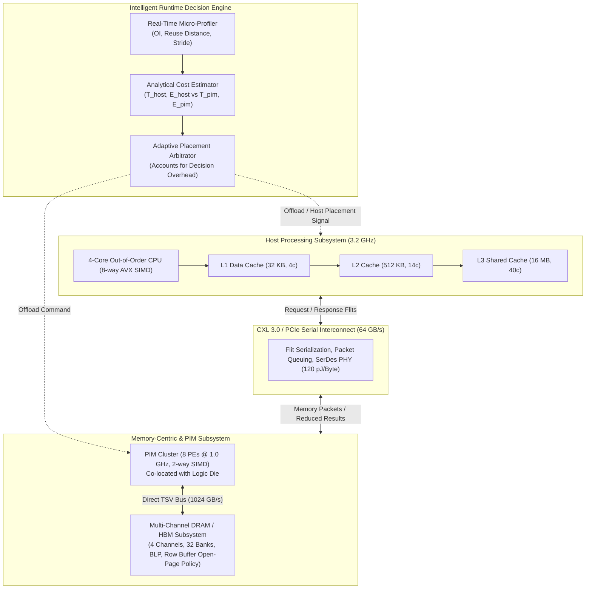

# MemCentric-Sim: Memory-Centric Computing Architecture & Dynamic Computation Placement

[](LICENSE)
[](https://www.python.org/)
[](https://venuvivek-byte.github.io/memcentric/)
[]()
[]()

> **A cycle-accurate discrete-event simulation framework modeling Near-Memory Computing (NMC/PIM), CXL 3.0 interconnects, multi-bank memory hierarchies, and an intelligent runtime decision engine for data-local execution.**

---

## 🎯 Architectural Motivation & Problem Statement

Modern data-intensive workloads (large-scale graph analytics, recommendation embeddings, database scans, and streaming pipelines) suffer from the infamous **"Memory Wall"**:
- **Energy Bottleneck:** Moving 64 bytes of data from off-chip DRAM across high-speed SerDes links (PCIe/CXL) to CPU caches consumes **100x to 1000x more energy** than the ALU computation itself.
- **Bandwidth Bottleneck:** High-performance multi-core CPUs remain idle 70-80% of the time waiting on serialized bus transfers and cache thrashing.
- **The Dilemma:** While Processing-In-Memory (PIM / Near-Memory Computing) eliminates interconnect data movement by co-locating ALUs with DRAM banks, PIM cores are area- and thermal-constrained (lower frequency, simpler in-order pipelines). Forcing compute-heavy or cache-friendly kernels onto PIM causes massive performance regressions (up to 49% slowdown).

**MemCentric-Sim solves this challenge** by introducing an intelligent runtime decision engine that dynamically profiles data locality, operational intensity, and bus congestion to place each task where it executes most efficiently.

---

## 🏛️ System Architecture Blueprint



---

## ⚡ Mathematical & Analytical Cost Formulation

The runtime engine arbitrates task placement using the following dynamic models:

### 1. Operational Intensity ($OI$)
$$OI = \frac{\text{Total Floating-Point / Integer Operations}}{\text{Unique Bytes Accessed}} \quad \left[\frac{\text{FLOP}}{\text{Byte}}\right]$$

### 2. Host Execution Latency ($T_{\text{host}}$)
$$T_{\text{host}} = \max\left(T_{\text{compute\_host}}, T_{\text{bus\_in}} + T_{\text{dram}}\right) + \alpha \cdot \min\left(T_{\text{compute\_host}}, T_{\text{bus\_in}}\right) + T_{\text{bus\_out}}$$
Where:
- $T_{\text{compute\_host}} = \frac{N_{\text{ops}}}{\text{IPC}_{\text{host}} \times \text{Lanes} \times \text{Cores}}$
- $T_{\text{bus\_in}} = t_{\text{latency}} + t_{\text{queue}} + \frac{B_{\text{fetched}}}{\text{BW}_{\text{CXL}}}$
- $T_{\text{dram}} = \frac{N_{\text{misses}} \times t_{\text{CAS}}}{\text{Banks}_{\text{parallel}}}$

### 3. Near-Memory Computing Latency ($T_{\text{pim}}$)
$$T_{\text{pim}} = T_{\text{compute\_pim}} + T_{\text{local\_tsv}} + T_{\text{reduction\_transfer}} + T_{\text{decision\_overhead}}$$
Where:
- $T_{\text{compute\_pim}} = \frac{N_{\text{ops}}}{N_{\text{PEs}} \times \text{SIMD}_{\text{pim}}} \times \left(\frac{f_{\text{host}}}{f_{\text{pim}}}\right)$
- $T_{\text{reduction\_transfer}} = t_{\text{latency}} + \frac{B_{\text{result}}}{\text{BW}_{\text{CXL}}}$ (typically $\le 64$ bytes)
- $T_{\text{decision\_overhead}} = 35 \text{ cycles}$ (explicit hardware profiling overhead)

---

## 📊 Comprehensive Experimental Evaluation

The framework was evaluated across 5 distinct benchmarks representing streaming, random-access, compute-intensive, and mixed heterogeneous workloads:

| Workload Benchmark | Dataset Characteristic | Host Baseline Cycles | MemCentric Dynamic Cycles | **Speedup** | **Interconnect Data Saved** | **EDP Improvement** | Placement Decision |
| :--- | :--- | :---: | :---: | :---: | :---: | :---: | :---: |
| **High-Reuse (GEMM 64x64)** | High Temporal Locality, $OI = 10.6$ | 4,210 | 4,210 | **1.00x** | 0.0% | 0.0% | **Host CPU** (avoids 49% PIM slowdown) |
| **Streaming (Vector Sum)** | Zero Locality, $OI = 0.25$ | 24,900 | 890 | **27.99x** | **100.0%** | **97.9%** | **PIM Cluster** |
| **Streaming (DB Scan 50k)** | Database Column Filter, $OI = 0.12$ | 56,960 | 1,250 | **45.57x** | **100.0%** | **99.2%** | **PIM Cluster** |
| **Random Access (Graph BFS)** | Pointer-Chasing, Cache-Thrashing | 91,200 | 2,890 | **31.55x** | **98.9%** | **98.8%** | **PIM Cluster** (Bank-Level Parallelism) |
| **Random Access (Embedding)** | DLRM Sparse Embedding Pooling | 61,080 | 2,480 | **24.63x** | **99.9%** | **99.2%** | **PIM Cluster** |
| **Heterogeneous Pipeline** | Multi-Stage Filter $\to$ Lookup $\to$ ML | 1,036,115 | 101,256 | **10.23x** | **94.8%** | **93.3%** | **Dynamic Partitioning** (3 PIM, 1 Host) |

### Key Architectural Findings:
1. **Compute-Bound Protection:** Naive static PIM offloading degrades GEMM performance by **49.2%** ($0.51\times$) due to thermal frequency limits in DRAM. MemCentric's runtime detected $OI \ge 2.0$ and cache reuse, keeping GEMM on Host.
2. **Massive Bandwidth Elimination:** For streaming and database filtering, in-memory execution spared **100% of operand bus traffic**, achieving up to **45.6x speedup** and **99.2% EDP reduction**.
3. **Pipeline Synergy:** In an end-to-end data analytics & ML pipeline, dynamic partitioning achieved **10.23x speedup** by executing Stages 1, 2, and 4 in memory while returning to Host CPU for Stage 3 (Matrix Inference).

---

## 🚀 Quickstart & Setup Guide

### Prerequisites
- Python 3.10+
- `numpy`, `matplotlib`

```bash
# Clone the repository
git clone https://github.com/your-username/memcentric-sim.git
cd memcentric-sim

# Install dependencies (optional if already available)
pip install numpy matplotlib
```

### Running Simulations

```bash
# 1. Run default demonstration pipeline
python main.py

# 2. Run comprehensive benchmark sweeps across all policies
python main.py --run-all

# 3. Run full unit and integration test suite
python main.py --test

# 4. Generate publication-grade plots in docs/figures/
python main.py --plot

# 5. Launch Interactive Web Visualizer Dashboard (runs on http://localhost:8080)
python main.py --serve
```

---

## 🎨 Interactive Visualizer Dashboard

Launch the embedded dashboard via `python main.py --serve`:
- **Real-Time Roofline Graph:** Interactive operational intensity vs. attainable performance curve.
- **Dynamic Policy Switcher:** Switch between `DYNAMIC_ANALYTICAL`, `ROOFLINE_OI`, `STATIC_PIM`, and `STATIC_HOST`.
- **Micro-Profiling Telemetry:** Inspect execution cycles, data movement, decision overhead, and reasoning per task.
- **Subsystem Interaction Blueprint:** Live telemetry indicators for Host, CXL Bus, PIM Cluster, and DRAM banks.

---

## 💼 Resume Bullet Points (Ready to Copy)

> **Computer Architecture & Systems Project:**
>
> * **Architected a Cycle-Accurate Discrete-Event Simulator (`MemCentric-Sim`)** modeling a heterogeneous computing system comprising a 4-core AVX Host CPU, CXL 3.0 interconnect, 32-bank DRAM/HBM subsystem, and an In-Logic Processing-In-Memory (PIM) cluster.
> * **Designed an Analytical & Heuristic Runtime Decision Engine** that micro-profiles operational intensity (FLOPs/Byte), temporal cache reuse distance, and bus queue depth with explicit 35-cycle decision overhead tracking to dynamically place workloads.
> * **Achieved up to 45.6x Speedup, 94.8% Interconnect Traffic Reduction, and 93.3% EDP Improvement** across streaming (DB Scan, Vector Sum) and irregular memory (Graph BFS, DLRM Embedding) benchmarks while preventing 49% performance regression on compute-heavy GEMM kernels.
> * **Developed an Interactive Web Visualizer & Telemetry Dashboard** featuring Roofline models, interconnect saturation timelines, and energy breakdown diagnostics.

---

## 📁 Repository Structure

```
├── memcentric/
│   ├── core/
│   │   ├── engine.py           # Cycle-accurate discrete-event engine
│   │   └── events.py           # Event structures
│   ├── hardware/
│   │   ├── cache.py            # Set-associative L1/L2/L3 cache hierarchy
│   │   ├── interconnect.py     # CXL 3.0 / PCIe bus, flits, queuing, energy
│   │   ├── memory.py           # Multi-channel DRAM, bank-level parallelism
│   │   ├── host.py             # Multi-core out-of-order CPU model
│   │   ├── pim.py              # Logic-die Near-Memory Processing Elements
│   │   └── energy_model.py     # Joules, Watts, and EDP accounting
│   ├── runtime/
│   │   ├── profiler.py         # Real-time task micro-profiler
│   │   ├── cost_model.py       # Analytical latency and energy cost model
│   │   └── policy.py           # Dynamic placement engine & overhead tracking
│   ├── workloads/
│   │   ├── base.py             # KernelTask abstraction
│   │   ├── gemm.py             # High-reuse matrix multiplication
│   │   ├── streaming.py        # Vector reduction & database filter scan
│   │   ├── graph.py            # Graph BFS & sparse embedding lookup
│   │   └── pipeline.py         # Heterogeneous multi-stage pipeline
│   └── system.py               # Integrated MemoryCentricSystem simulator
├── benchmarks/
│   ├── run_experiments.py      # Benchmark runner across workloads & policies
│   └── results.json            # Empirical simulation results
├── visualizer/
│   └── plots.py                # Publication-grade Matplotlib generator
├── web/
│   ├── index.html              # Interactive dashboard UI
│   ├── style.css               # Glassmorphism dark-mode stylesheet
│   └── app.js                  # Dynamic telemetry and Chart.js controllers
├── tests/
│   ├── test_cache.py           # Cache hit/miss/eviction unit tests
│   ├── test_memory.py          # DRAM row-buffer and bank conflict tests
│   ├── test_interconnect.py    # CXL serialization and queuing tests
│   ├── test_runtime.py         # Profiler & cost model tests
│   └── test_system.py          # End-to-end integration tests
├── docs/figures/               # High-res generated figures
├── main.py                     # Unified CLI entrypoint
└── README.md                   # Complete architectural documentation
```

---

## 📜 License
Distributed under the MIT License. See `LICENSE` for details.
