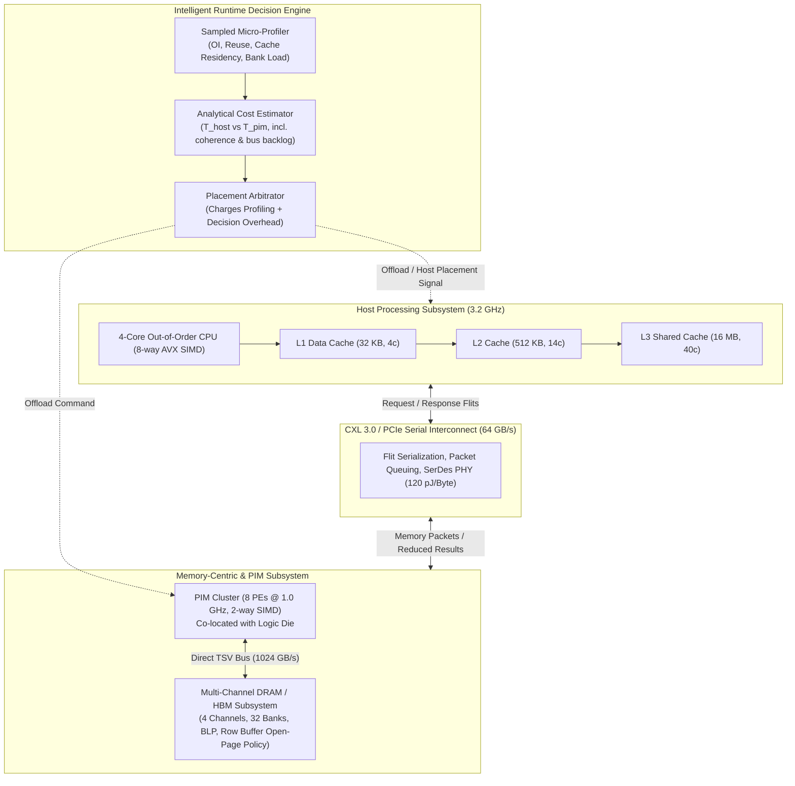
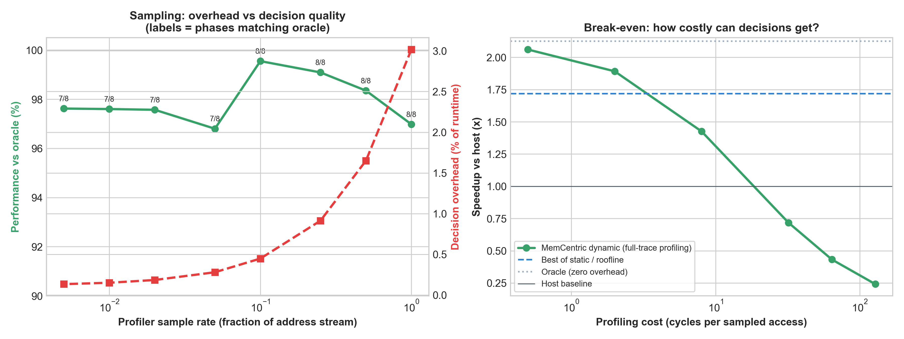

# MemCentric-Sim: Memory-Centric Computing Architecture & Dynamic Computation Placement

[](LICENSE)
[](https://www.python.org/)
[](https://venuvivek-byte.github.io/memcentric/)
[]()
[]()

> **A discrete-event, transaction-level simulation framework modeling Near-Memory Computing (NMC/PIM), CXL 3.0 interconnects, multi-bank memory hierarchies, and an intelligent runtime decision engine for data-local execution.**

---

## 🎯 Architectural Motivation & Problem Statement

Modern data-intensive workloads (large-scale graph analytics, recommendation embeddings, database scans, and streaming pipelines) suffer from the infamous **"Memory Wall"**:
- **Energy Bottleneck:** Moving 64 bytes of data from off-chip DRAM across high-speed SerDes links (PCIe/CXL) to CPU caches consumes **100x to 1000x more energy** than the ALU computation itself.
- **Bandwidth Bottleneck:** High-performance multi-core CPUs remain idle 70-80% of the time waiting on serialized bus transfers and cache thrashing.
- **The Dilemma:** While Processing-In-Memory (PIM / Near-Memory Computing) eliminates interconnect data movement by co-locating ALUs with DRAM banks, PIM cores are area- and thermal-constrained (lower frequency, simpler in-order pipelines). Forcing compute-heavy or cache-friendly kernels onto PIM causes massive performance regressions (GEMM runs at 0.51x on PIM in our model).

**MemCentric-Sim solves this challenge** by introducing an intelligent runtime decision engine that dynamically profiles data locality, operational intensity, and bus congestion to place each task where it executes most efficiently.

---

## 🏛️ System Architecture Blueprint



---

## 🔁 How a Task Moves Through the System

Execution is event-driven. Every task passes through the discrete-event queue in [memcentric/core/engine.py](memcentric/core/engine.py):

| Event | What happens |
| :--- | :--- |
| `DMABurst` | Another device (storage / NIC) pushes data over the shared CXL link. It occupies the link but is not counted as workload traffic. |
| `TaskArrival` | The runtime samples the task's address stream, probes the host caches for the task's lines, maps lines to DRAM banks, and reads the current link backlog. |
| `TaskDispatch` | Fires after the decision overhead. The task starts on HOST or PIM. Before a PIM launch, every host-cached copy of the task's lines is invalidated and dirty lines are written back over the link (coherence). |
| `TaskComplete` | Fires when the target finishes; the next task arrives. |

Component state persists across tasks: what one task leaves in the caches, open DRAM rows and bus reservations all affect the next decision.

---

## ⚡ Runtime Decision Model

### 1. Profiling (sampled, with cost)
The micro-profiler ([profiler.py](memcentric/runtime/profiler.py)) inspects a random fraction `q` of the address stream (default 10%) and measures:
- **Working set** `U`. Lines seen 3+ times in the sample are treated as hot and fully captured. For the rest, the ratio of lines seen twice (`f2`) to lines seen once (`f1`) gives the average reuse $c \approx 1 + \frac{2(1-q)f_2}{q f_1}$, and $U \approx \text{accesses}/c$.
- **Data location**: the fraction of the working set already **resident** and **dirty** in the host caches (side-effect-free tag probes), the load on the **busiest DRAM bank**, and **open-row hit rates** obtained by replaying the bank mapping.
- **Operational intensity**, reuse, and reduction ratio.

Profiling cost $= 25 + 0.5 \times (\text{samples} + \text{tag probes} + \text{window})$ cycles. Static policies pay nothing. Roofline pays for profiling plus a 5-cycle compare, and the cost model adds 35 cycles to evaluate.

### 2. Cost model (parameterised from the simulated hardware)
[cost_model.py](memcentric/runtime/cost_model.py) is built with `AnalyticalCostModel.from_hardware(...)`, so its constants are the simulator's:

$$T_{\text{host}} = T_{\text{compute}} + T_{\text{cache}} + N_{\text{miss}}\,(t_{\text{req}} + t_{\text{dram}} + t_{\text{resp}}) + \max(0,\ Q_{\text{bus}} - T_{\text{compute}})$$

$$T_{\text{pim}} = N_{\text{dirty}}\, t_{\text{line}} + L_{\text{bank,max}}\, t_{\text{dram}} + T_{\text{compute,pim}} + T_{\text{result}}$$

- $N_{\text{miss}}$ counts only lines **not already in the host caches**.
- $N_{\text{dirty}}$ is the coherence write-back the host must do before an offload.
- $Q_{\text{bus}}$ is the live link backlog observed at arrival.
- $t_{\text{dram}}$ blends row-hit and row-conflict latency using the profiled row-hit rate.

The task goes where it is predicted to finish first.

### 3. Oracle (evaluation only)
`ORACLE` deep-copies the machine state at each arrival, runs the task on both targets, and keeps the faster one, with zero decision overhead. It is the upper bound that the other policies are measured against.

---

## 📊 Experimental Evaluation

All numbers below are produced by `python main.py --run-all` (see [benchmarks/results.json](benchmarks/results.json)). Cycles are host cycles at 3.2 GHz.

| Workload | Host only | PIM only | Roofline-OI | **MemCentric dynamic** | Speedup | Bus data saved | EDP gain | vs. Oracle | Decision overhead | Placement |
| :--- | ---: | ---: | ---: | ---: | :---: | :---: | :---: | :---: | :---: | :---: |
| High-Reuse (GEMM) | 72,966 | 142,630 | 73,586 | 73,616 | **0.99x** | 0.0% | -0.9% | 99.1% | 0.88% | H=1 P=0 |
| Streaming (Vector Sum) | 533,302 | 19,022 | 19,543 | 19,573 | **27.25x** | 100.0% | 97.8% | 97.2% | 2.81% | H=0 P=1 |
| Streaming (DB Scan) | 681,843 | 14,927 | 15,663 | 15,693 | **43.45x** | 100.0% | 99.1% | 95.1% | 4.88% | H=0 P=1 |
| Random Access (Graph BFS) | 270,180 | 8,530 | 9,139 | 9,169 | **29.47x** | 98.9% | 98.8% | 93.0% | 6.97% | H=0 P=1 |
| Random Access (Embedding) | 126,142 | 5,087 | 5,298 | 5,328 | **23.68x** | 99.9% | 99.1% | 95.5% | 4.52% | H=0 P=1 |
| Heterogeneous Pipeline | 1,035,975 | 170,346 | 102,893 | 103,013 | **10.06x** | 94.8% | 93.2% | 98.2% | 1.84% | H=1 P=3 |
| **Mixed-Dataset Session** | 2,035,653 | 2,172,289 | 1,185,084 | **962,352** | **2.12x** | 64.5% | 53.7% | **99.5%** | 0.45% | H=4 P=4 |

### The mixed-dataset session (one system, three kinds of data)
This is the brief's context example: one continuous run over a reusable dataset, streaming datasets and randomly accessed datasets ([memcentric/workloads/mixed.py](memcentric/workloads/mixed.py)).

| Phase | Data | Dynamic | Roofline-OI | Why they differ |
| :--- | :--- | :---: | :---: | :--- |
| S1 Ingest transform | reusable (hot weights) | HOST 587,594 | HOST 587,564 | |
| S2 Hot-buffer aggregate | streaming, **already dirty in host caches** | **HOST 1,781** | PIM 195,752 | Low OI sends roofline to PIM, which must first write back 4,096 dirty lines |
| S3 Cold table scan | streaming, DRAM only | PIM 15,707 | PIM 15,677 | |
| S4 Embedding gather | random | PIM 5,525 | PIM 5,495 | |
| S5 Model GEMM | reusable | HOST 73,922 | HOST 74,034 | |
| S6 Feature cross, quiet bus | moderate OI (~11 FLOP/B) | HOST 123,287 | HOST 123,257 | |
| S7 Same kernel, **1 MB DMA on the bus** | moderate OI | **PIM 145,353** | HOST 174,152 | Dynamic sees a 62k-cycle link backlog and moves near memory |
| S8 Graph frontier | random | PIM 9,183 | PIM 9,153 | |

The same kernel (S6 vs S7) is placed differently depending on runtime bus state. Streaming data (S2 vs S3) is placed differently depending on where the data currently lives. Dynamic placement chooses the same target as the oracle in all 8 phases.

### Feasibility and overhead of dynamic placement


From [benchmarks/overhead_study.json](benchmarks/overhead_study.json):
- **Sampling.** Profiling the full trace costs 3.0% of runtime. Sampling 10% costs 0.45% with no loss in decision quality (8/8 phases match the oracle). Below 5% sampling, the working-set estimate gets noisy and one phase is misplaced, which lands at 97% of oracle.
- **Break-even.** With full-trace profiling, dynamic placement keeps beating the best static/roofline policy up to about 2 cycles per sampled access (10.9% overhead). At 8 cycles per sample, overhead reaches 33% and the advantage is gone. At 32 or more, it is slower than never deciding at all.
- **Prediction error** of the cost model on the chosen target ranges from −12.5% to +31% (mixed session). Every decision has a wider margin than that error.

### Key findings
1. **Compute-bound protection.** Static PIM offload halves GEMM performance (0.51x). Both runtime policies keep it on the host.
2. **Bandwidth elimination.** Streaming and random-access kernels run 24–45x faster near memory and send 99–100% less data over the link.
3. **Runtime state matters.** Operational intensity alone (roofline) loses 19% to the oracle on the mixed session. It ignores cache residency (the coherence write-back) and bus congestion. The state-aware model gets within 0.5% of the oracle.
4. **Overhead is the limiting factor for single-kernel workloads.** When one placement is obviously right (pure streaming), decision cost is pure loss: dynamic reaches 93–97% of the oracle there.

### Limitations
- **Transaction-level timing.** The host issues all of a task's misses at once, and the link serialises them in issue order; there is no out-of-order core model.
- **Address stream known at launch.** The profiler reads the address stream before the task runs. This assumes the runtime can see access descriptors, for example from the compiler or DMA descriptors.
- **One decision per task.** Placement is decided once per task (kernel granularity). There is no mid-kernel migration, and host and PIM do not run concurrently.
- **Policy overlap.** `ADAPTIVE_CONGESTION` now gives the same decisions as `DYNAMIC_ANALYTICAL`, because the dynamic model already sees bus congestion.

---

## 🚀 Quickstart & Setup Guide

### Prerequisites
- Python 3.10+
- `numpy`, `matplotlib`

```bash
# Clone the repository
git clone https://github.com/your-username/memcentric-sim.git
cd memcentric-sim

# Install dependencies (optional if already available)
pip install numpy matplotlib
```

### Running Simulations

```bash
# 1. Run the mixed-dataset session demo (host baseline vs dynamic placement)
python main.py

# 2. Run all benchmarks, the oracle, the overhead study; regenerate figures + dashboard data
python main.py --run-all

# 3. Run full unit and integration test suite
python main.py --test

# 4. Generate publication-grade plots in docs/figures/
python main.py --plot

# 5. Launch Interactive Web Visualizer Dashboard (runs on http://localhost:8080)
python main.py --serve
```

---

## 🎨 Interactive Visualizer Dashboard

Launch the embedded dashboard via `python main.py --serve`:
- **Real-Time Roofline Graph:** Interactive operational intensity vs. attainable performance curve.
- **Dynamic Policy Switcher:** Switch between `DYNAMIC_ANALYTICAL`, `ROOFLINE_OI`, `ADAPTIVE_CONGESTION`, `STATIC_PIM`, `STATIC_HOST`, and `ORACLE`.
- **Real data:** every number comes from `web/data.js`, written by `benchmarks/run_experiments.py`.
- **Micro-Profiling Telemetry:** Inspect execution cycles, data movement, decision overhead, and reasoning per task.
- **Subsystem Interaction Blueprint:** Live telemetry indicators for Host, CXL Bus, PIM Cluster, and DRAM banks.

---

## 💼 Resume Bullet Points (Ready to Copy)

> **Computer Architecture & Systems Project:**
>
> * **Built a discrete-event simulator (`MemCentric-Sim`)** of a heterogeneous system: a 4-core SIMD host with an L1/L2/L3 hierarchy, a CXL link shared with background DMA traffic, a 32-bank DRAM subsystem, and a near-memory PIM cluster, with coherence write-back on offload.
> * **Designed a runtime placement engine** that samples 10% of each kernel's address stream to estimate working set, cache residency, DRAM bank load and bus backlog. It charges its own profiling and decision overhead (0.45% of runtime).
> * **Matched an oracle's placement on all 8 phases of a mixed-dataset session** (99.5% of oracle performance, 2.12x over host, 19% faster than a roofline policy) and reached 24–45x speedup on streaming and random-access kernels, while keeping GEMM off PIM to avoid its 2x slowdown.
> * **Developed an Interactive Web Visualizer & Telemetry Dashboard** featuring Roofline models, interconnect saturation timelines, and energy breakdown diagnostics.

---

## 📁 Repository Structure

```
├── memcentric/
│   ├── core/
│   │   └── engine.py           # Discrete-event engine (priority event queue)
│   ├── hardware/
│   │   ├── cache.py            # Set-associative L1/L2/L3 cache hierarchy
│   │   ├── interconnect.py     # CXL 3.0 / PCIe bus, flits, queuing, energy
│   │   ├── memory.py           # Multi-channel DRAM, bank-level parallelism
│   │   ├── host.py             # Multi-core out-of-order CPU model
│   │   ├── pim.py              # Logic-die Near-Memory Processing Elements
│   │   ├── dma.py              # Background DMA agent sharing the interconnect
│   │   └── energy_model.py     # Joules, Watts, and EDP accounting
│   ├── runtime/
│   │   ├── profiler.py         # Real-time task micro-profiler
│   │   ├── cost_model.py       # Analytical latency and energy cost model
│   │   └── policy.py           # Dynamic placement engine & overhead tracking
│   ├── workloads/
│   │   ├── base.py             # KernelTask abstraction
│   │   ├── gemm.py             # High-reuse matrix multiplication
│   │   ├── streaming.py        # Vector reduction & database filter scan
│   │   ├── graph.py            # Graph BFS & sparse embedding lookup
│   │   ├── pipeline.py         # Heterogeneous multi-stage pipeline
│   │   └── mixed.py            # Mixed-dataset session (residency + congestion)
│   └── system.py               # Integrated MemoryCentricSystem simulator
├── benchmarks/
│   ├── run_experiments.py      # Benchmark runner across workloads & policies
│   ├── results.json            # Per-workload, per-policy results
│   └── overhead_study.json     # Sampling / profiling-cost sweeps, prediction error
├── visualizer/
│   └── plots.py                # Publication-grade Matplotlib generator
├── web/
│   ├── index.html              # Interactive dashboard UI
│   ├── style.css               # Glassmorphism dark-mode stylesheet
│   ├── app.js                  # Dynamic telemetry and Chart.js controllers
│   └── data.js                 # Generated benchmark data for the dashboard
├── tests/
│   ├── test_cache.py           # Cache hit/miss/eviction unit tests
│   ├── test_memory.py          # DRAM row-buffer and bank conflict tests
│   ├── test_interconnect.py    # CXL serialization and queuing tests
│   ├── test_runtime.py         # Profiler & cost model tests
│   ├── test_system.py          # End-to-end integration tests
│   └── test_placement_dynamics.py  # Events, coherence, congestion, overhead, oracle
├── docs/figures/               # High-res generated figures
├── main.py                     # Unified CLI entrypoint
└── README.md                   # Complete architectural documentation
```

---

## 📜 License
Distributed under the MIT License. See `LICENSE` for details.
